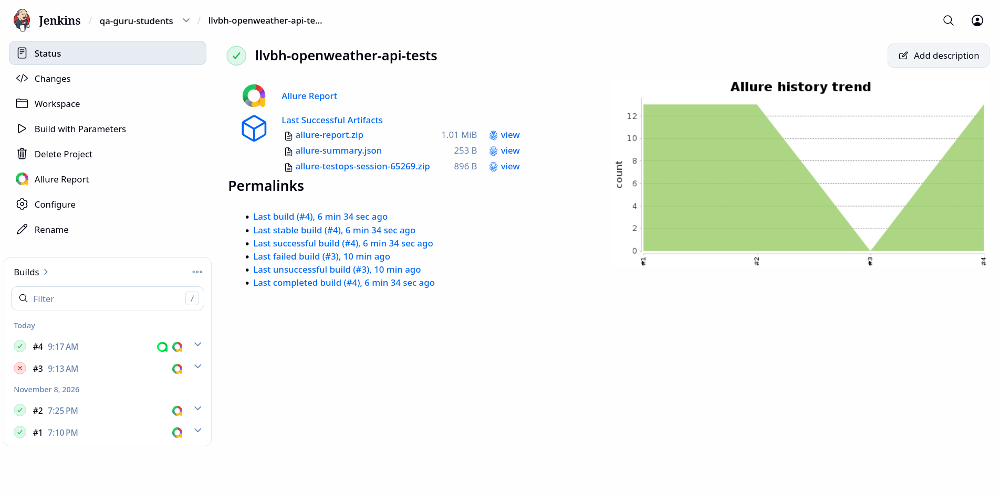
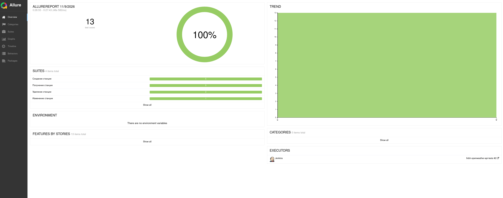
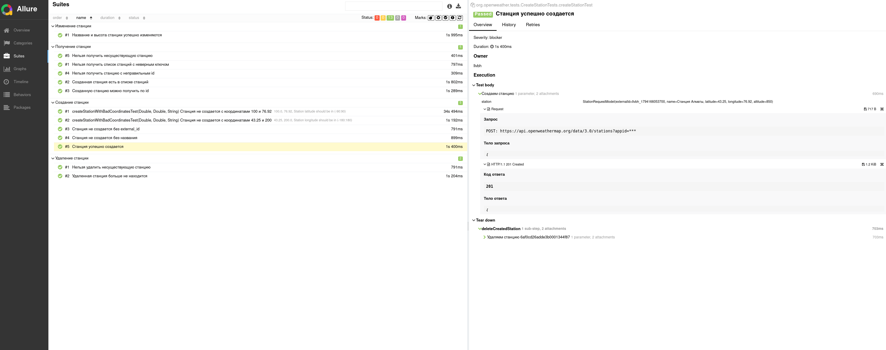
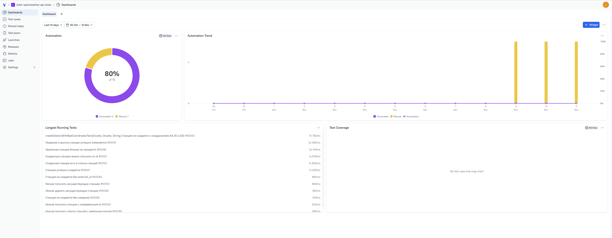
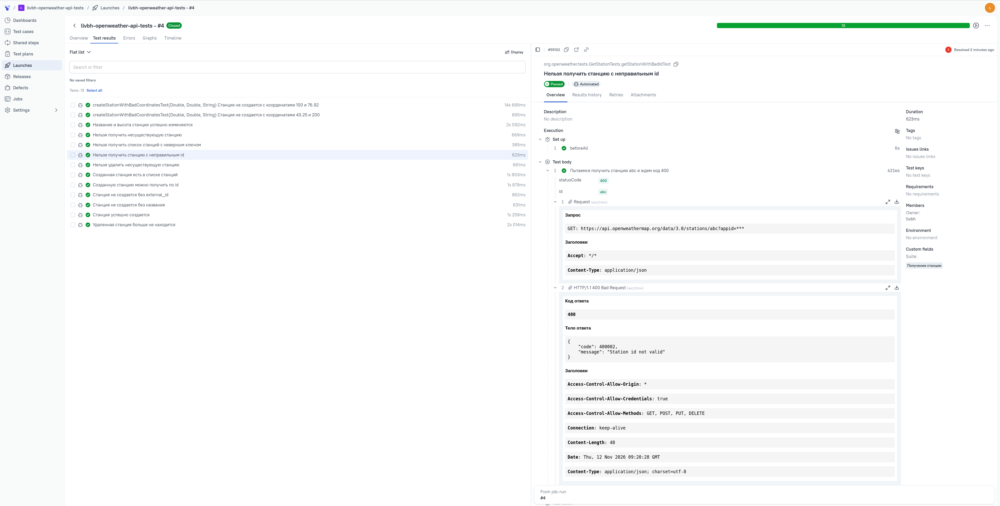
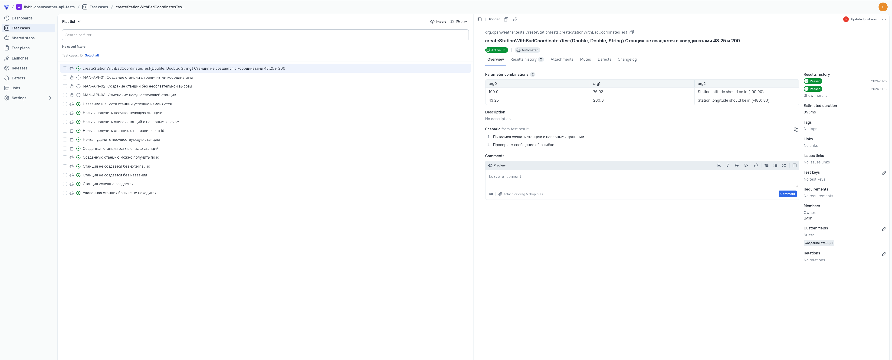
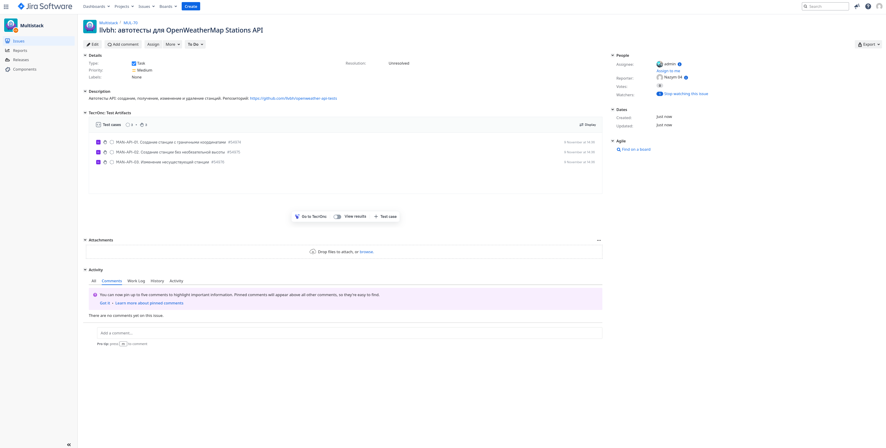
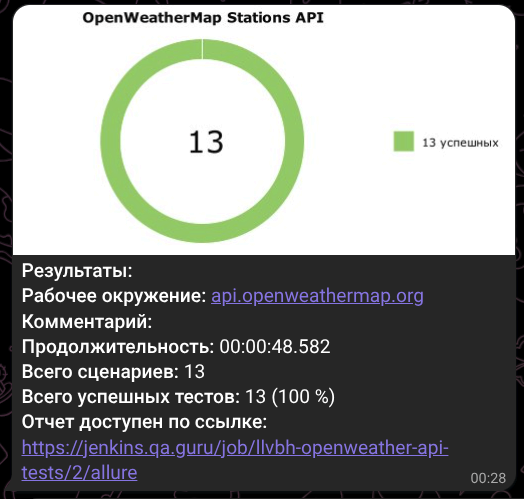

<a id="readme-top"></a>
<p align="center">
<a href="https://openweathermap.org/"></a>
</p>

# Проект по автоматизации тестирования API <a href="https://openweathermap.org/stations">OpenWeatherMap Stations</a>

> OpenWeatherMap — сервис с данными о погоде. Weather Stations API позволяет создавать свои метеостанции и управлять ими

## :scroll: Содержание:

- <a href="#tools">Использованные инструменты</a>
- <a href="#cases">Реализованные тесты</a>
- <a href="#console">Запуск тестов из терминала</a>
- <a href="#jenkins">Сборка в Jenkins</a>
- <a href="#allure">Allure-отчет</a>
- <a href="#testops">Интеграция с Allure TestOps</a>
- <a href="#jira">Интеграция с Jira</a>
- <a href="#telegram">Уведомление в Telegram</a>

<a id="tools"></a>
## :hammer_and_wrench: Использованные инструменты

<p align="center">
<a href="https://www.java.com/"></a>
<a href="https://www.jetbrains.com/idea/"></a>
<a href="https://github.com/"></a>
<a href="https://junit.org/junit5/"></a>
<a href="https://gradle.org/"></a>
<a href="https://rest-assured.io/"></a>
<a href="https://github.com/allure-framework"></a>
<a href="https://qameta.io/"></a>
<a href="https://www.atlassian.com/software/jira"></a>
<a href="https://www.jenkins.io/"></a>
<a href="https://web.telegram.org/"></a>
</p>

Тесты написаны на языке <code>Java</code> с использованием <code>REST Assured</code>, сборщик — <code>Gradle</code>, запуск через <code>JUnit 5</code>.

В проекте есть:
- модели на <code>Lombok</code> для тела запроса и для ответа
- спецификации запросов и ответов
- Allure-листенер со своими шаблонами запроса и ответа

Для удаленного запуска сделана джоба в <code>Jenkins</code> с формированием Allure-отчета и отправкой результатов в <code>Telegram</code> при помощи бота.

<a id="cases"></a>
## :ballot_box_with_check: Реализованные тесты

### Создание станции
- Станция успешно создается
- Станция не создается без `external_id`
- Станция не создается без названия
- Станция не создается с неправильными координатами

### Получение станции
- Созданную станцию можно получить по id
- Созданная станция есть в списке станций
- Нельзя получить несуществующую станцию
- Нельзя получить станцию с неправильным id
- Нельзя получить список станций с неверным ключом

### Изменение станции
- Название и высота станции успешно изменяются

### Удаление станции
- Удаленная станция больше не находится
- Нельзя удалить несуществующую станцию

<p align="right"><a href="#readme-top">наверх</a></p>

<a id="console"></a>
## :computer: Запуск тестов из терминала

Для запуска нужен API-ключ, его можно получить на сайте <a href="https://openweathermap.org/">OpenWeatherMap</a> после регистрации:
```
./gradlew clean test -DapiKey=<ключ>
```

Сформировать и открыть Allure-отчет:
```
./gradlew allureServe
```

<p align="right"><a href="#readme-top">наверх</a></p>

<a id="jenkins"></a>
##  Сборка в [Jenkins](https://jenkins.qa.guru/job/llvbh-openweather-api-tests/)

<p align="center">

</p>

### Параметры сборки в Jenkins:
- `API_KEY` — API-ключ OpenWeatherMap
- `TELEGRAM_TOKEN`, `TELEGRAM_CHAT` — токен бота и чат для уведомлений

<p align="right"><a href="#readme-top">наверх</a></p>

<a id="allure"></a>
##  [Allure-отчет](https://jenkins.qa.guru/job/llvbh-openweather-api-tests/allure/)

В отчете для каждого теста есть шаги, запросы и ответы. API-ключ в адресах запросов заменяется на `***`.

<p align="center">

</p>

### Тест-кейсы

<p align="center">

</p>

<p align="right"><a href="#readme-top">наверх</a></p>

<a id="testops"></a>
##  Интеграция с [Allure TestOps](https://allure.qa.guru/project/5426/dashboards)

Результаты каждой сборки в <code>Jenkins</code> загружаются в <code>Allure TestOps</code>. Дополнительные проверки API описаны там же как ручные тест-кейсы.

### Дашборд

<p align="center">

</p>

### Запуск тестов

<p align="center">

</p>

### Автоматизированные и ручные тест-кейсы

<p align="center">

</p>

<p align="right"><a href="#readme-top">наверх</a></p>

<a id="jira"></a>
## [Интеграция с Jira](https://jira.qa.guru/browse/MUL-70)

В задаче на разработку API-автотестов привязаны ручные тест-кейсы из <code>Allure TestOps</code>.

<p align="center">

</p>

<p align="right"><a href="#readme-top">наверх</a></p>

<a id="telegram"></a>
##  Уведомление в Telegram при помощи бота

После выполнения тестов бот отправляет сообщение с результатами прогона.

<p align="center">

</p>

<p align="right"><a href="#readme-top">наверх</a></p>
